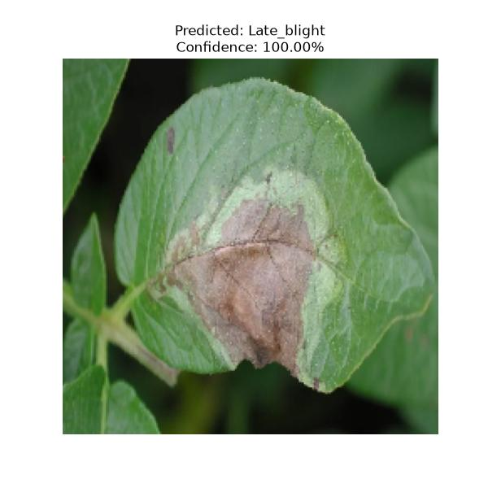
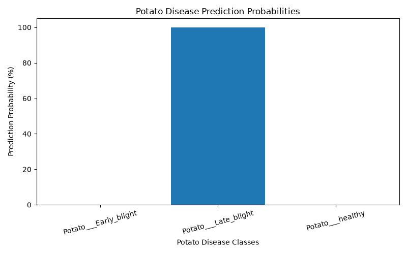
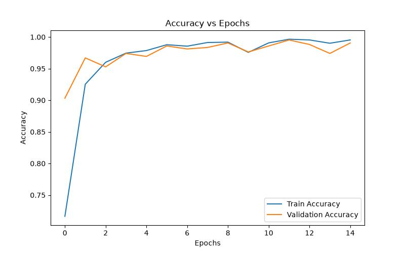
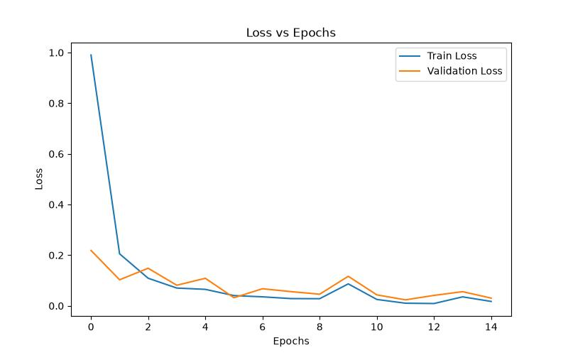

🥔 Potato Plant Disease Detection Using VGG16

A deep learning project that uses Convolutional Neural Networks (CNN) and VGG16 Transfer Learning to identify diseases in potato leaves.

The system classifies potato leaf images into three categories: Early Blight, Late Blight and Healthy. It also displays prediction confidence scores and visualizations.

📌 Project Overview

Potato plants are affected by diseases that can reduce crop quality and productivity. This project aims to identify common potato leaf conditions using image classification.

A pre-trained VGG16 model with ImageNet weights is used to extract image features and classify potato leaf images.

Disease Categories

| Category | Description |
|---|---|
| Early Blight | Identifies potato leaves affected by early blight |
| Late Blight | Identifies potato leaves affected by late blight |
| Healthy | Identifies healthy potato leaves |

🛠️ Technologies Used

- Language: Python
- Deep Learning: TensorFlow and Keras
- Model: VGG16
- Libraries: NumPy, Matplotlib
- Development Environment: Visual Studio Code
- Technique: Transfer Learning and CNN

📂 Dataset Description

The dataset contains 2,152 potato leaf images divided into three classes.

| Class | Images |
|---|---:|
| Early Blight | 1,000 |
| Late Blight | 1,000 |
| Healthy | 152 |
| Total | 2,152 |

Data Preprocessing

- Images resized to 224 × 224 pixels.
- VGG16 preprocessing applied.
- Dataset divided into 80% training and 20% testing data.
- Random horizontal flipping and rotation used for data augmentation.

🧠 Model Architecture

The project uses the VGG16 model pre-trained on ImageNet.

The classification architecture consists of:

1. Data Augmentation
2. VGG16 Base Model
3. Flatten Layer
4. Dense Layer – 128 neurons with ReLU activation
5. Dropout Layer – 50%
6. Output Layer – 3 neurons with Softmax activation

Model Configuration

| Parameter | Value |
|---|---|
| Base Model | VGG16 |
| Pre-trained Weights | ImageNet |
| Input Size | 224 × 224 × 3 |
| Optimizer | Adam |
| Learning Rate | 0.0001 |
| Loss Function | Sparse Categorical Crossentropy |
| Evaluation Metric | Accuracy |
| Epochs | 15 |

The last four layers of the VGG16 base model are fine-tuned during training.

⚙️ Project Workflow

1. Collect potato leaf images.
2. Preprocess and resize the images.
3. Split the dataset into training and testing sets.
4. Apply data augmentation.
5. Load the pre-trained VGG16 model.
6. Train and fine-tune the model.
7. Evaluate the model using accuracy and loss.
8. Predict diseases from new leaf images.
9. Display prediction confidence and visualizations.

📁 Project Structure

```text
Potato_Plant_Disease_Detection_Using_VGG16/
│
├── dataset/
│   ├── Potato___Early_blight/
│   ├── Potato___Late_blight/
│   └── Potato___healthy/
│
├── model/
│   ├── potato_disease_model.keras
│   └── training_history.json
│
├── test_images/
│
├── main.py
├── predict.py
├── requirements.txt
└── README.md
```

🚀 How to Run the Project

1. Clone the Repository

```bash
git clone <your-github-repository-link>
```

2. Navigate to the Project Folder

```bash
cd Potato_Plant_Disease_Detection_Using_VGG16
```

3. Create a Virtual Environment

```bash
python -m venv venv
```

4. Activate the Environment (Windows)

```bash
venv\Scripts\activate
```

5. Install Dependencies

```bash
pip install -r requirements.txt
```

6. Train the Model

```bash
python main.py
```

7. Run Disease Prediction

Place a potato leaf image inside the `test_images` folder and update the image path in `predict.py`.

Then execute:

```bash
python predict.py
```

Note: The trained model and training history are saved in the `model` folder after training.

📊 Results and Visualizations

The project generates the following outputs:

- Predicted potato leaf disease.
- Prediction confidence score.
- Probability distribution for all three classes.
- Input image with predicted class and confidence.
- Training and validation accuracy graph.
- Training and validation loss graph.

📸 Project Screenshots


1. Disease Prediction Output



2. Prediction Probability Graph



3. Training and Validation Accuracy



4. Training and Validation Loss



🔮 Future Improvements

- Expand the dataset with more diverse potato leaf images.
- Evaluate the model using independent real-world images.
- Develop a web application for image-based disease detection.
- Provide detailed disease treatment and prevention recommendations.

👨‍💻 Author

Asad Razi

B.E. – Artificial Intelligence and Machine Learning

Project: Potato Plant Disease Detection Using VGG16
